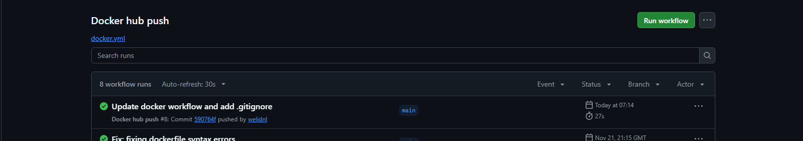
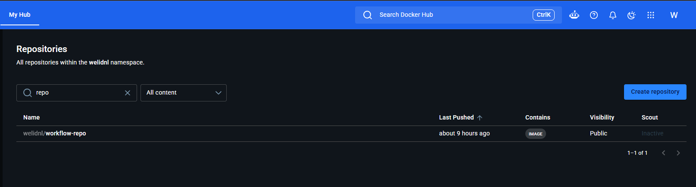

# CD-docker-image

This is a Workflow I built that demonstrates how you can use Continuous Deployment to build and push an Image to a container registry (in this case Docker Hub). 

## What the Project Does:

Whenever code is pushed to the main branch an automated workflow runs to:

1. **Set up and check the code**: Installs Node on the runner and prepares the app.
2. **Build & Deploy**: Packages the Node application into a Docker container and uploads it to Docker Hub.

## Repository Structure:

```text
.
├── .github/
│   └── workflows/
│       └── docker.yml      # CI/CD workflow
├── app_node/
│   ├── Dockerfile          # Image definition
│   └── rock-game.js        # Rock, Paper, Scissors app
└── README.md
```

### Continuous Delivery (CD)

The workflow lives at `.github/workflows/docker.yml` and runs as a single `build` job on an `ubuntu-latest` runner.

**Triggers**
- Every push to the `main` branch
- Manually, using `workflow_dispatch` from the Actions tab

**Steps:**

1. **Checkout code** (`actions/checkout@v7`) clones the repository onto the runner so the Dockerfile and app source are available.
2. **Set up Node.js** (`actions/setup-node@v4`) installs Node 20 on the runner.
3. **Log in to Docker Hub** (`docker/login-action@v3`) authenticates using the `DOCKERHUB_USERNAME` and `DOCKERHUB_PAT` secrets, so no credentials are stored in the repository.
4. **Build and push** (`docker/build-push-action@v6`) builds the image using `app_node` as the build context and pushes it to Docker Hub as `welidnl/workflow-repo:v1.0`.

**The Docker image**

The `Dockerfile` in `app_node/` uses `node:20-slim` as the base image, copies `rock-game.js` into `/rock-game`, and runs it with `node rock-game.js` when the container starts.

**Secrets:**

Add these under *Settings → Secrets and variables → Actions*:

| Secret | Purpose |
|--------|---------|
| `DOCKERHUB_USERNAME` | Docker Hub account name |
| `DOCKERHUB_PAT` | Docker Hub personal access token (create one under Account Settings → Personal access tokens) |

### Running the Image

```bash
docker pull welidnl/workflow-repo:v1.0
docker run  welidnl/workflow-repo:v1.0
```

### Screenshots

**Successful GitHub Actions run**



**Image published on Docker Hub**




## Technologies used:

GitHub Actions, Docker, Docker Hub, Node.js

